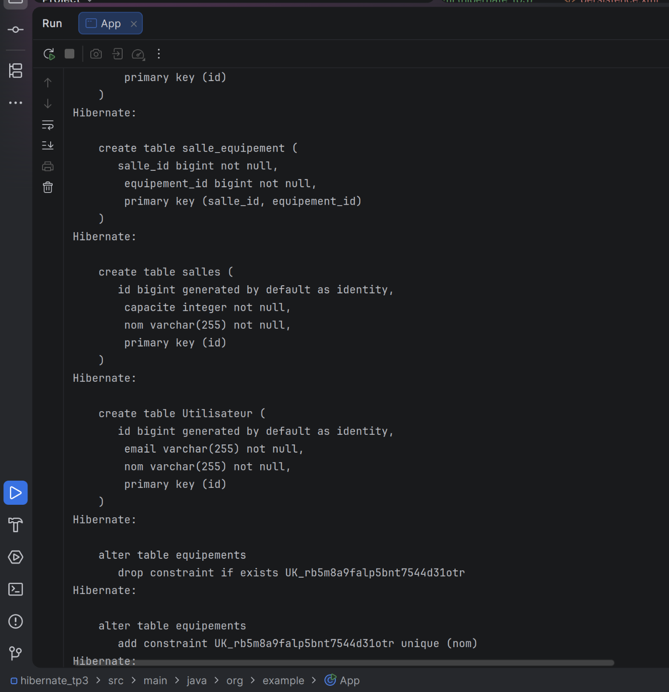
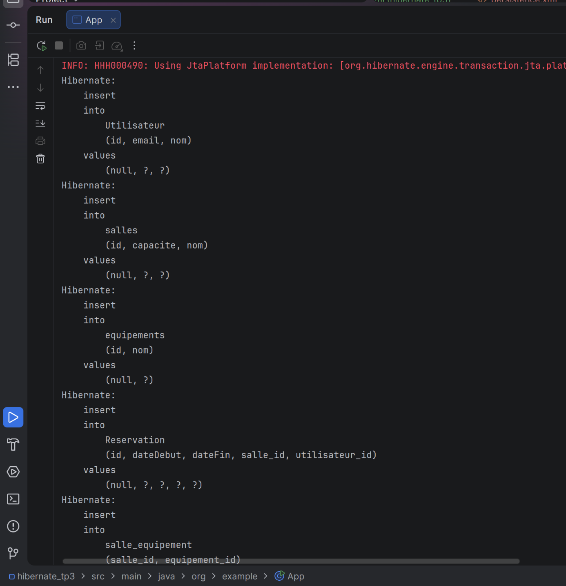
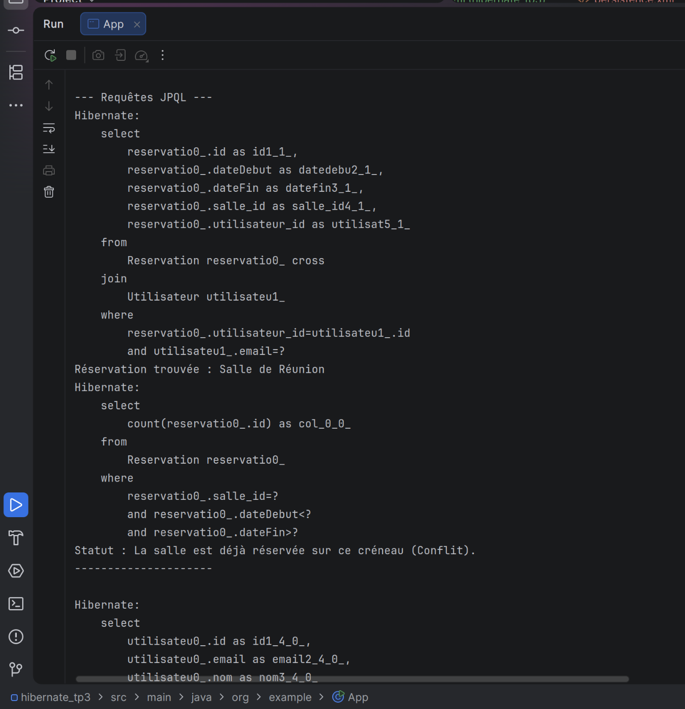
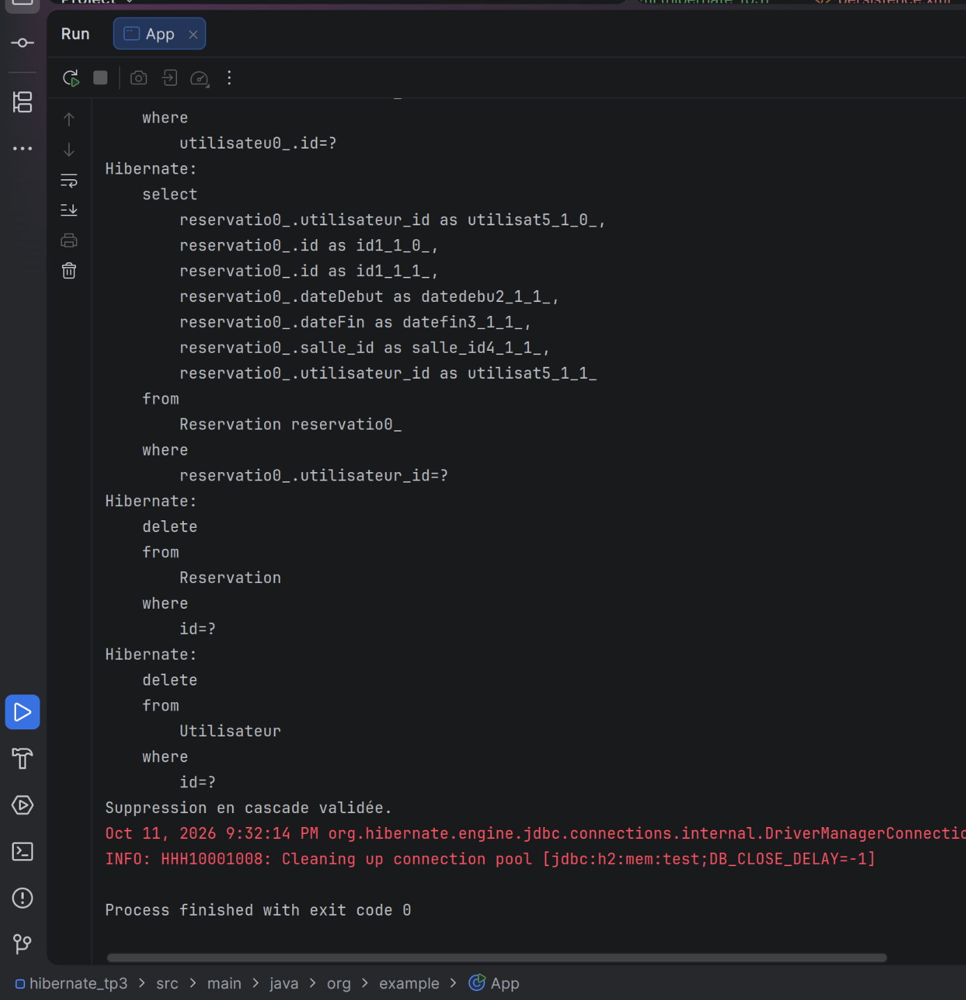

TP 3 - Gestion avancée des entités avec JPA et Hibernate

**1. Création du schéma de la base de données**
Hibernate génère automatiquement les tables et les contraintes de clés étrangères au démarrage.

**2. Persistance des entités**
Sauvegarde d'un utilisateur, d'une salle avec équipement et d'une réservation. La cascade gère l'ordre des requêtes insert.

**3. Requêtes JPQL**
Récupération de la liste des réservations par email et vérification de la disponibilité d'une salle sur un créneau.

**4. Suppression en cascade**
Suppression d'un utilisateur qui entraine automatiquement la suppression de ses réservations pour respecter la base de données.
